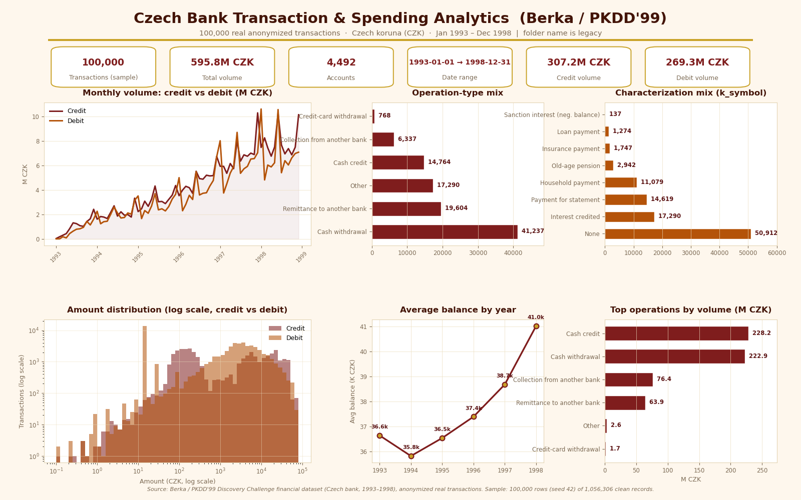

# Czech Bank Transaction & Spending Analytics (Berka / PKDD'99)

> **Honesty note:** the folder name `saudi-pos-spending-dashboard` is **legacy** and misleading — this project has nothing to do with Saudi POS spending. It is a spending/transaction analytics dashboard built on the **Berka / PKDD'99** Czech bank dataset, and the folder name was kept only to preserve existing paths.



## Dataset (real, not synthetic)

The dashboard is built on **real anonymized bank transactions** from the **PKDD'99 Discovery Challenge** financial dataset, prepared by **Petr Berka** (Czech bank, 1993–1998, currency: Czech koruna — CZK). The distribution archive is publicly redistributed; the copy used here:

- Original: `http://lisp.vse.cz/pkdd99/DATA/data_berka.zip`
- Download used by `download_data.py`: `https://web.archive.org/web/20070214120527/http://lisp.vse.cz/pkdd99/DATA/data_berka.zip` (Internet Archive copy of the original PKDD'99 distribution)

We use the transaction table (`trans.asc`). Cleaning + sampling, applied identically by `download_data.py`:

1. Read the 1,056,320 raw rows in chunks (semicolon-delimited, header row).
2. Parse `date` from `YYMMDD`; drop rows with non-positive/missing `amount` or unparseable date → **1,056,306** clean rows.
3. Deterministic random sample of **100,000 rows (seed 42)** → saved to `data/bank_transactions.csv` (**100,000 rows × 10 columns**).

## Column reference / translation (Czech → English)

| Column | Czech code | English meaning |
|---|---|---|
| `type` | `PRIJEM` | Credit — money **in** |
| `type` | `VYDAJ` | Debit — money **out** |
| `type` | `VYBER` | Cash withdrawal (type-level category) |
| `operation` | `VKLAD` | Cash credit |
| `operation` | `VYBER` | Cash withdrawal |
| `operation` | `VYBER KARTOU` | Credit-card withdrawal |
| `operation` | `PREVOD Z UCTU` | Collection from another bank |
| `operation` | `PREVOD NA UCET` | Remittance to another bank |
| `operation` | *(empty)* | Other |
| `k_symbol` | `POJISTNE` | Insurance payment |
| `k_symbol` | `SLUZBY` | Payment for statement |
| `k_symbol` | `UROK` | Interest credited |
| `k_symbol` | `SANKC. UROK` | Sanction interest (negative balance) |
| `k_symbol` | `SIPO` | Household payment |
| `k_symbol` | `DUCHOD` | Old-age pension |
| `k_symbol` | `UVER` | Loan payment |
| `k_symbol` | *(empty)* | None |
| `date` | `YYMMDD` | e.g. `930101` = 1993-01-01 |
| `amount` / `balance` | — | Czech koruna (CZK) |

CSV schema (`data/bank_transactions.csv`): `trans_id, account_id, date, type, operation, amount, balance, k_symbol, bank, account`.

## Key insights (computed from the real data, 100k-row sample)

- **Scale:** 100,000 transactions · 4,492 accounts · **595.8M CZK** total volume · 1993-01-01 → 1998-12-31.
- **Credit vs debit:** debits (VYDAJ) are **60.1%** of transactions (60,077) vs credits (PRIJEM) 38.4% (38,391) — but **credit volume (307.2M CZK) exceeds debit volume (269.3M CZK)**: net money inflow over the period. (A further 1.5% / 1,532 rows are type-level cash withdrawals.)
- **Top operation by volume:** Cash credit (VKLAD) **228.2M CZK**; **top by count:** Cash withdrawal (VYBER) **41,237 transactions**. Remittances to another bank 19,604; inter-bank collections 6,337; **credit-card withdrawals only 768 transactions (0.8%)** — cards were barely used in this era.
- **Top k_symbol categories:** Interest credited (UROK) 17,290 · Payment for statement (SLUZBY) 14,619 · Household payment (SIPO) 11,079 · Old-age pension (DUCHOD) 2,942 · Insurance payment (POJISTNE) 1,747 · Loan payment (UVER) 1,274 · Sanction interest 137 · no characterization 50,912.
- **Peak month:** **June 1998** — 21.2M CZK across 2,685 transactions (followed by Jan 1998, 18.4M).
- **Growth:** yearly volume grew ~9× from 20.4M CZK (1993) to **182.3M CZK (1998)**; transaction count 2,660 → 30,617.
- **Balances:** average account balance dipped in 1994 (35.8k CZK), then rose steadily to **41.0k CZK in 1998**.
- **Ticket sizes (median):** credit 1,700 CZK · debit 2,082 CZK · type-level withdrawal 12,345.50 CZK.

## Tech stack

Python · pandas · matplotlib · numpy (dashboard rendered with the Agg backend, 1600×1000 px).

## How to run

```bash
pip install -r requirements.txt

# Option A: download the original PKDD'99 archive, clean + sample it (seed 42)
python3 download_data.py

# Option B: reuse the already-prepared sample in data/
python3 dashboard.py      # renders dashboard.png
```

## Power BI version

Two ready-made Python visuals (same burgundy/cream/gold design as `dashboard.png`) — each script reads only the injected `dataset` (no file loading):
- **Page 1 — Overview** (`powerbi-page1-overview.py`): KPI cards + monthly trend + avg balance + volume share + top operations + net flow. Drag into the visual's Values well: `date`, `type`, `amount`, `balance`, `operation`, `account_id`.
- **Page 2 — Details** (`powerbi-page2-details.py`): operation mix + k_symbol mix + amount distribution + yearly stacked volume + median by type. Drag into Values: `date`, `type`, `operation`, `amount`, `k_symbol`.

Full Arabic walkthrough (fastest path, slicers, Python prerequisite) plus the manual DAX + native-visuals alternative: **[powerbi-guide.md](powerbi-guide.md)**.
